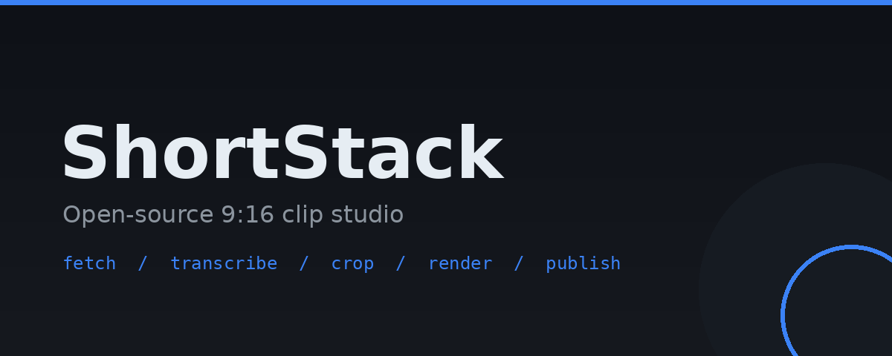
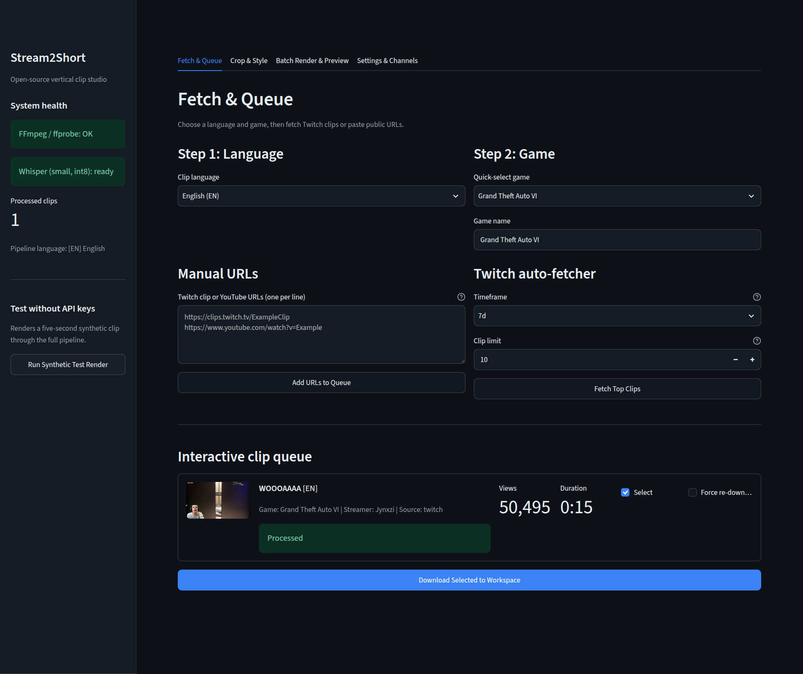
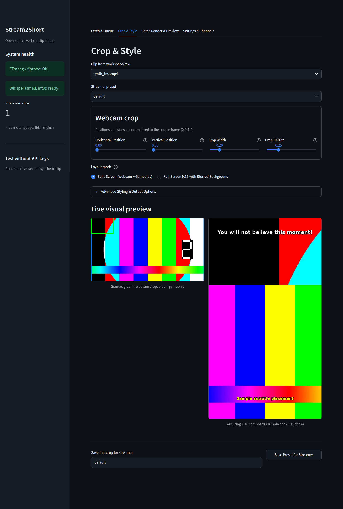
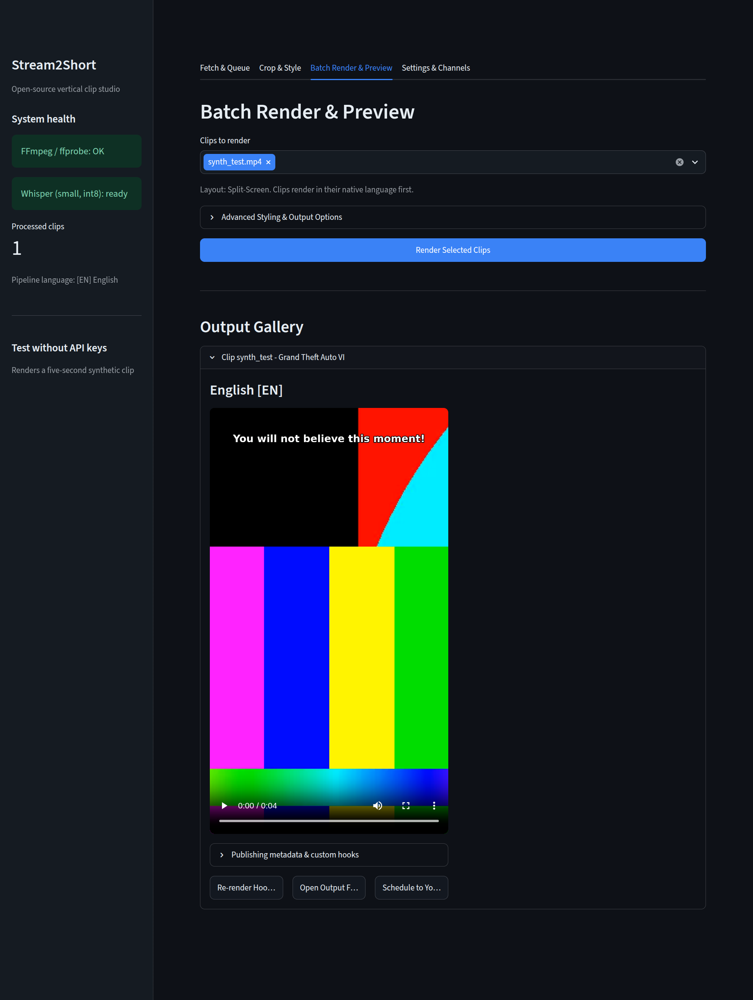
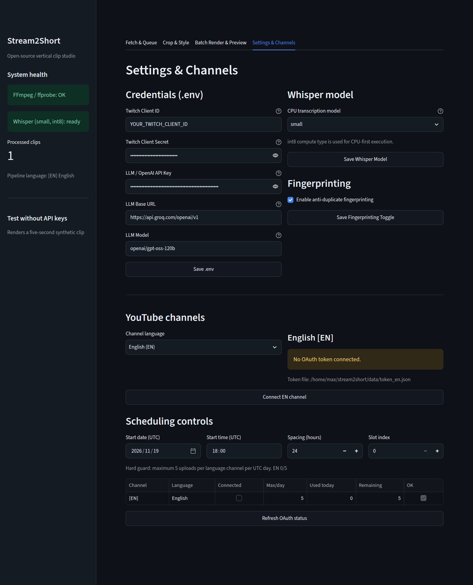

# Stream2Short

[](https://www.python.org/)
[](LICENSE)
[](https://streamlit.io/)
[](https://github.com/astral-sh/ruff)

Stream2Short is a local-first Streamlit studio that turns gaming clips into 9:16 vertical shorts and videos. It fetches clips for any Twitch game, transcribes speech in its native language, composites 1080x1920 video with FFmpeg, and optionally schedules uploads to per-language YouTube channels.



## Capabilities

- **Multi-language Twitch discovery.** Resolves any Twitch game by name, paginates clip results, and filters by ISO 639-1 language directly on the client.
- **CPU int8 Whisper transcription.** Runs faster-whisper locally on CPU with int8 quantization. No GPU is required.
- **Interactive 9:16 crop studio.** Adjusts the webcam region, layout mode, subtitle typography, and safe zones with live source and composite previews.
- **FFmpeg compositing.** Generates 1080x1920 output with split-screen webcam/gameplay or full-screen blurred backgrounds.
- **Optional YouTube scheduling.** Connects per-language OAuth channels, uploads with ISO 8601 publishAt timestamps, and enforces a five-upload daily quota per channel.
- **Zero-key verification.** Renders a synthetic clip through the entire pipeline without requiring Twitch, LLM, or YouTube credentials.

## Pipeline

```text
Twitch Helix or public URL
            |
            v
   yt-dlp download
   workspace/raw/<clip_id>.mp4
            |
            v
   faster-whisper (CPU int8)
   .ass subtitles + localized metadata
            |
            v
   FFmpeg 9:16 compositor
   output/<lang>/<clip_id>_<lang>.mp4
            |
            +--> optional anti-duplicate fingerprinting
            |
            +--> optional YouTube publishAt scheduling
```

## Quickstart

### Automated launcher

#### Linux / macOS

```bash
# 1. Install system prerequisites (Ubuntu / Debian example)
sudo apt update && sudo apt install -y ffmpeg fonts-dejavu-core fonts-noto-cjk xdg-utils

# 2. Run the automated launcher (creates .venv, installs dependencies, launches Streamlit)
./start.sh
```

#### Windows

```bat
:: Run the launcher in Command Prompt or PowerShell (requires Python 3.10+ and FFmpeg on PATH)
start.bat
```

### Manual installation

1. Install system packages.

   ```bash
   sudo apt update
   sudo apt install -y ffmpeg fonts-dejavu-core fonts-noto-cjk xdg-utils
   ```
2. Create a virtual environment and install Python dependencies.

   ```bash
   python3 -m venv .venv
   source .venv/bin/activate
   pip install -r requirements.txt
   ```
3. Configure optional credentials.

   ```bash
   cp .env.example .env
   $EDITOR .env
   ```

   Twitch credentials enable automated clip discovery. LLM credentials enable model-generated metadata and translation. Public Twitch and YouTube URLs work without credentials.
4. Launch the studio.

   ```bash
   streamlit run app.py
   ```

## Interface Walkthrough

The studio interface is organized into four tabs:

### 1. Fetch & Queue

Select target language and game, then fetch clips via Twitch Helix or paste public URLs directly into the queue.



### 2. Crop & Style

Calibrate webcam coordinates, toggle split-screen and blurred layouts, adjust subtitle typography, and save per-streamer crop presets.



### 3. Batch Render & Preview

Render queued clips in their native language or generate translated variants. Review side-by-side vertical video players and localized publishing metadata.



### 4. Settings & Channels

Manage `.env` credentials, select Whisper transcription models, toggle anti-duplicate fingerprinting, and authorize per-language YouTube channels.




## Output Structure

Outputs are organized per language:

```text
output/
├── en/<clip_id>_en.mp4
├── uk/<clip_id>_uk.mp4
├── es/<clip_id>_es.mp4
└── ...
```

Webcam crops are saved in `presets.json`. YouTube OAuth tokens and upload history are maintained in `data/`.

## Configuration

### Environment variables (`.env`)

| Variable                             | Required             | Description                                                           |
| ------------------------------------ | -------------------- | --------------------------------------------------------------------- |
| `TWITCH_CLIENT_ID`                 | For Twitch discovery | Client ID from the Twitch Developer Console.                          |
| `TWITCH_CLIENT_SECRET`             | For Twitch discovery | Client secret for app access token generation.                        |
| `LLM_API_KEY` / `OPENAI_API_KEY` | No                   | API key for an OpenAI-compatible endpoint.                            |
| `LLM_BASE_URL`                     | No                   | API base URL. Defaults to `https://api.groq.com/openai/v1`.         |
| `LLM_MODEL`                        | No                   | Metadata and translation model. Defaults to `llama-3.1-8b-instant`. |

Without an LLM key, Stream2Short uses built-in localized templates with `deep-translator` fallbacks.

### `config.yaml`

| Key                           | Default                                      | Description                                                            |
| ----------------------------- | -------------------------------------------- | ---------------------------------------------------------------------- |
| `default_game`              | `Grand Theft Auto VI`                      | Game used by the fetcher and metadata templates.                       |
| `default_language`          | `en`                                       | Source language when a clip has no stored language.                    |
| `supported_languages`       | `[en, uk, es, de, fr, pl, pt, ru, ja, ko]` | Language codes shown in the user interface.                            |
| `width` / `height`        | `1080` / `1920`                          | Output resolution (9:16 aspect ratio).                                 |
| `whisper_model`             | `small`                                    | CPU transcription model: `tiny`, `base`, `small`, or `medium`. |
| `compute_type`              | `int8`                                     | faster-whisper quantization type.                                      |
| `font_family`               | `DejaVu Sans`                              | Subtitle font family.                                                  |
| `font_size`                 | `36`                                       | Subtitle text size at 1080x1920.                                       |
| `primary_color`             | `#FFFF00`                                  | Subtitle fill color.                                                   |
| `outline_thickness`         | `2`                                        | Subtitle outline width in pixels.                                      |
| `margin_v`                  | `220`                                      | Bottom safe zone in pixels.                                            |
| `anti_duplicate_enabled`    | `true`                                     | Enables subtle zoom, colour grading, and speed adjustments.            |
| `anti_duplicate_scale`      | `1.04`                                     | Fingerprint zoom factor.                                               |
| `anti_duplicate_contrast`   | `1.03`                                     | Fingerprint contrast adjustment factor.                                |
| `anti_duplicate_saturation` | `1.05`                                     | Fingerprint saturation adjustment factor.                              |
| `anti_duplicate_speed`      | `1.02`                                     | Playback speed factor (subtitles are rescaled proportionally).         |

### YouTube OAuth

1. Enable the YouTube Data API v3 in the Google Cloud Console.
2. Create an OAuth Desktop Application client and save credentials to `data/client_secret.json`.
3. Open **Settings & Channels**, choose a language, and click **Connect Channel**.
4. Repeat for additional languages. Tokens are stored as `data/token_<lang>.json`.

Scheduling applies ISO 8601 `publishAt` timestamps with configurable spacing and enforces a five-upload daily quota per language channel.

## Architecture

| Path                    | Responsibility                                                                              |
| ----------------------- | ------------------------------------------------------------------------------------------- |
| `app.py`              | Streamlit studio user interface and pipeline orchestration.                                 |
| `src/languages.py`    | ISO 639-1 normalization, language names, badges, and code validation.                       |
| `src/fetcher.py`      | Twitch Helix game resolution, paginated language filtering, and yt-dlp media downloads.     |
| `src/transcriber.py`  | faster-whisper transcription, ASS subtitle generation, localized metadata, and translation. |
| `src/renderer.py`     | FFmpeg 9:16 compositor, safe UTF-8 textfile banners, and fingerprinting filters.            |
| `src/fonts.py`        | Cross-platform font file and font family resolution (Linux, macOS, Windows).                |
| `src/ffmpeg_bin.py`   | Cross-platform FFmpeg and ffprobe binary detection with imageio-ffmpeg fallback.            |
| `src/uploader.py`     | YouTube Data API v3 uploads with per-language OAuth tokens and quota tracking.              |
| `tests/smoke_test.py` | Zero-key end-to-end English and Ukrainian verification.                                     |

## Verification

```bash
# 1. Syntax check
.venv/bin/python -m py_compile app.py src/*.py tests/smoke_test.py

# 2. Code style & linting
.venv/bin/ruff check .

# 3. Native EN and UK synthetic pipeline (zero API keys required)
.venv/bin/python tests/smoke_test.py --model tiny
```

The smoke test generates a synthetic testsrc/sine clip, runs Whisper, produces native metadata and subtitles, renders `output/en/synth_test_en.mp4` and `output/uk/synth_test_uk.mp4`, and verifies H.264/AAC 1080x1920 streams, distinct fingerprints, and cleanup.

## License

Released under the MIT License. Copyright (c) 2026 Stream2Short contributors. See [`LICENSE`](LICENSE).
